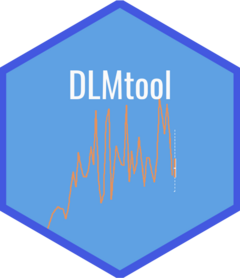

 
<!-- README.md is generated from README.Rmd. Please edit that file -->

```{r, include = FALSE}
library(badger)
knitr::opts_chunk$set(
  collapse = TRUE,
  comment = "#>",
  fig.path = "man/figures/README-",
  out.width = "100%"
)
```

# DLMtool 

<!-- badges: start -->
[](https://CRAN.R-project.org/package=DLMtool)
[](https://github.com/Blue-Matter/DLMtool/actions)
`r badge_devel("blue-matter/DLMtool", "blue")`
<!-- badges: end -->

The Data-Limited Methods toolkit (`DLMtool`) is a library of over 100
data-limited management procedures (MPs) for use in fisheries management
strategy evaluation (MSE). It is part of the
[openMSE](https://openMSE.com) collection of R packages.

## openMSE 2.0

`DLMtool` 7.0 is part of the `openMSE` 2.0 release, alongside `MSEtool`
4.0. `MSEtool` 4.0 introduces a modular operating model structure, with
stock, fleet, observation, and implementation components defined as
independent objects, and a closed-loop MSE workflow based on `om`,
`hist`, and `mse` objects, replacing the earlier `OM`, `Hist`, and `MSE`
classes. The [technical documentation](https://docs.openMSE.com) covers
this workflow with worked examples.

`DLMtool`'s management procedures (MPs) predate this new structure and
are written against the legacy `Data` and `Rec` classes. They remain
fully supported: `MSEtool::Convert()` automatically converts between
the new `data` class and the legacy `Data` class, so existing MPs run
unchanged in either engine. See [NEWS](https://dlmtool.openmse.com/news/)
for details of what changed in this release.

## Key Features

- **Large MP library**: output control (TAC), input control (effort,
  size limits, spatial closures), and mixed-control MPs, ranging from
  simple catch-based rules to model-based estimators
- **Works with `MSEtool` v4.0+**: legacy MPs run directly against
  `data`-class objects produced by `MSEtool`'s current `om`/`data`
  simulation engine, via automatic object conversion (`MSEtool::Convert()`)
- **Works with the legacy engine**: MPs remain fully compatible with the
  original `OM`/`Data` classes for existing workflows
- **Plain R functions**: every MP is a function that accepts a `Data`
  object and returns a `Rec` (recommendation) object, so new MPs are easy
  to write and test
- **Diagnostic tools**: functions for checking MP behaviour and data
  requirements before running a full MSE

Not every legacy MP maps cleanly onto the new engine: a small number
rely on legacy-only `Data` slots (e.g., `Data@Abun`, `Data@FMSY_M`,
`Data@BMSY_B0`) that `MSEtool`'s new observation model does not yet
populate when converting `data` to `Data`. These MPs fail with an
informative error rather than silently returning an invalid
recommendation; see `?Required` for each MP's data requirements.

## Installation

You can install the released version of DLMtool from [CRAN](https://CRAN.R-project.org) with:

``` r
install.packages("DLMtool")
```

And the development version from [GitHub](https://github.com/) with:

``` r
# install.packages("pak")
pak::pak("Blue-Matter/DLMtool")
```

## Documentation

- **[openMSE.com](https://openMSE.com)**: general information about the
  openMSE framework
- **[docs.openMSE.com](https://docs.openMSE.com)**: technical manual
  with worked examples covering operating model construction,
  simulation, and MSE analysis
- **[dlmtool.openmse.com](https://dlmtool.openmse.com)**: full function
  reference for `DLMtool`
- **[msetool.openmse.com](https://msetool.openmse.com)**: function
  reference for `MSEtool`, the core package providing the new `om`/`data`
  simulation engine

